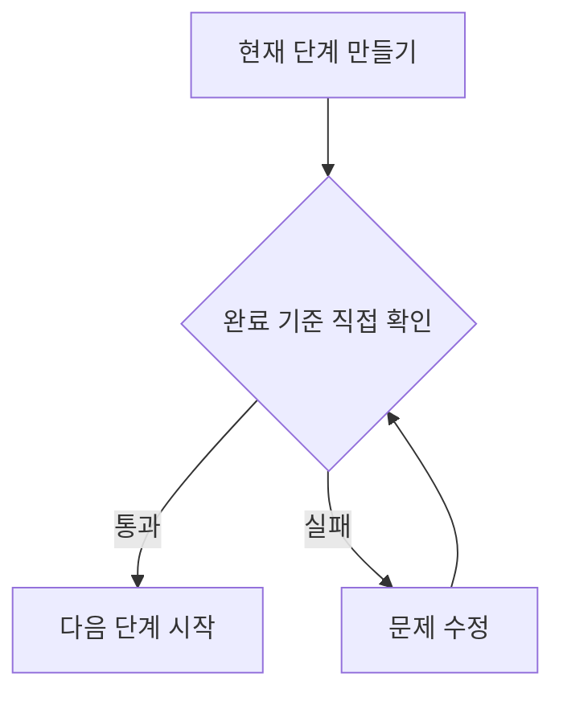

# 🎬 영화 티어리스트 개발 계획서

> **목표** · 내가 본 영화를 S / A / B / C / D로 정리하고, 나중에 다시 열거나 파일·이미지로 남긴다.  
> **사용 방식** · 로그인·서버 실행 없이 HTML 파일 하나를 연다. 영화 검색과 포스터 표시, PNG 저장에는 인터넷이 필요하다.

## 1쪽 · 무엇부터 만들까?

### 🎯 목적에 따른 우선순위

| 우선순위 | 꼭 만들 기능 | 필요한 이유 |
|---|---|---|
| **① 먼저: 분류하기** | 추가한 영화 목록, S~D 배정, 등급 변경·삭제 | 본 영화를 내 기준으로 정리하는 핵심 기능이다. |
| **② 다음: 기록 지키기** | 여러 책갈피, 자동 저장, JSON 저장·불러오기 | 서로 다른 분류표를 따로 관리하고 다시 이어서 쓴다. |
| **③ 완성: 편하게 쓰고 남기기** | TMDB 검색·포스터, PNG 저장, 좁은 화면 대응 | 영화를 쉽게 찾고 완성한 분류표를 보관한다. |

**세 묶음 모두 원문의 완성 범위다.** 우선순위는 만드는 순서이며, 실제 작업 순서는 아래 1~6단계를 따른다. 원문에 없는 기능은 추가하지 않는다.

### 🛠️ 앞부분: 화면 → 분류 → 자동 저장

| 단계 | 할 일 | 눈에 보이는 결과물 | 다음 단계로 넘어갈 완료 기준 |
|---|---|---|---|
| **1. 화면 뼈대** | 검색창·설정, 추가 목록, S~D 다섯 줄, 저장 버튼을 배치한다. 제목만 있는 연습용 카드로 먼저 만든다. | HTML 한 장으로 열리는 기본 화면 | 다섯 등급과 추가 목록이 구분된다. 위는 좁고 아래는 넓은 피라미드이며, 노란색이 아래로 갈수록 진해진다. |
| **2. 영화 분류** | 목록에서 등급으로 끌어 놓기, 등급 간 이동, 카드 클릭 시 등급 변경·삭제를 만든다. 목록 양쪽에 더보기 버튼을 붙인다. | 영화를 직접 정리할 수 있는 분류표 | 목록→S→B 이동 때 카드가 한 곳에만 남는다. 클릭 메뉴로도 이동·삭제된다. 빈 목록에는 안내가 뜨고, 더 넘길 곳이 없으면 더보기 버튼이 꺼진다. |
| **3. 책갈피·자동 저장** | 제목을 정해 책갈피를 여러 개 만든다. 영화·등급·배치를 책갈피별로 나누고 변경할 때 브라우저에 자동 저장한다. | 다시 열어도 남는 여러 분류표 | 두 책갈피의 배치가 서로 섞이지 않는다. 같은 브라우저에서 같은 파일을 다시 열면 제목·영화·등급·배치가 복원된다. 삭제한 초기 영화가 되살아나지 않는다. |

**첫 행동:** HTML 파일을 만들고, ‘추가한 영화 목록’과 S~D 다섯 줄부터 화면에 띄운다. 검색 연결은 4단계에서 붙인다.

---

## 2쪽 · 언제 다음 단계로 넘어갈까?

### 🔗 뒷부분: 실제 검색 → 백업 → 최종 확인

| 단계 | 할 일 | 눈에 보이는 결과물 | 다음 단계로 넘어갈 완료 기준 |
|---|---|---|---|
| **4. 검색·포스터** | 설정에서 TMDB API 키(v3)를 입력받는다. 제목 검색 결과에 포스터·제목·‘목록에 추가’를 보여 준다. 빈 입력, 중복, 키 오류, 연결 오류를 안내한다. | 실제 영화를 찾아 추가하는 화면 | 검색→결과→목록 추가가 된다. 공백만 넣으면 카드가 안 생긴다. 현재 책갈피의 목록·티어에 같은 제목이 있으면 중복 안내가 뜬다. 포스터 실패 시 회색 제목 카드가 보인다. |
| **5. 파일 저장·불러오기** | JSON 파일(분류 기록을 담는 파일)로 현재 책갈피 또는 전체 책갈피를 저장한다. 불러올 때 백업 선택과 교체 확인을 거친다. | 기록을 내보내고 되가져오는 기능 | 현재/전체 저장 범위가 맞고 다시 불러오면 기록이 돌아온다. ‘백업 후 불러오기’는 현재 기록을 먼저 저장한다. 취소하거나 잘못된 파일을 넣으면 기존 기록이 유지된다. |
| **6. PNG·최종 확인** | 현재 책갈피의 티어 영역을 PNG로 저장한다. 모바일·좁은 창에서 화면과 버튼을 확인하고 전체 흐름을 점검한다. | 원문의 완성 기준을 확인할 수 있는 HTML 한 장 | PNG에 S~D와 영화 제목이 들어가고 추가 목록은 빠진다. 포스터가 빠져도 제목이 남는다. 좁은 화면에서 오른쪽이 잘리지 않고 클릭 메뉴로 등급을 바꿀 수 있다. 아래 최종 점검을 모두 통과한다. |

### 🚦 단계마다 같은 규칙으로 진행

**동작이 안 되면 해당 단계에서 고친다.** 표의 완료 기준은 앞으로 확인할 조건이며, 개발·검증을 마쳤다는 뜻은 아니다.

### ✅ 마지막에 한 번에 확인하기

| 점검 묶음 | 직접 해 볼 일 |
|---|---|
| **검색·분류** | 영화 검색→목록 추가→S 배정→B 이동→삭제. 공백 검색·같은 제목 재추가·포스터 실패도 확인한다. |
| **책갈피·보관** | 책갈피 두 개를 다르게 꾸민 뒤 다시 연다. 현재/전체 JSON을 각각 저장·복원하고, 불러오기 취소 때 기록이 남는지 확인한다. |
| **이미지·실행 환경** | PNG를 열어 제목과 저장 범위를 확인한다. HTML을 바로 열고, PC와 모바일·좁은 창에서 내용과 조작 버튼을 확인한다. |

### 📌 구현할 때 놓치지 않을 원문 조건

- **초기 목록:** 원문의 영화 10편을 첫 실행 때 추가 목록에 넣는다. 키 저장 뒤 빠진 포스터를 채우고, 이후에는 사용자의 수정·삭제 기록을 우선한다.
- **키 관리:** 키는 해당 브라우저의 localStorage(브라우저 저장 공간)에만 저장한다. HTML 코드와 내보내는 JSON에는 넣지 않는다. 키 미입력·인증 실패·네트워크 오류를 구분해 안내한다.
- **불러오기 순서:** ‘백업 후 불러오기 / 그냥 불러오기 / 취소’ 선택 → 백업 선택 시 JSON 저장 → ‘현재 목록이 교체됩니다’ 확인 → 교체한다.
- **외부 연결:** 검색·포스터는 TMDB, 이미지 저장은 html2canvas를 사용한다. PNG는 티어 영역만 담고, 포스터가 빠지면 제목 카드로 남길 수 있도록 한다.

*작성 근거: 「영화티어리스트 기획서 자료(1).md」의 목적·화면과 동작·데이터 저장·완성 기준. 개발 순서와 단계별 점검 방법은 원문을 바탕으로 구성한 계획이다.*
