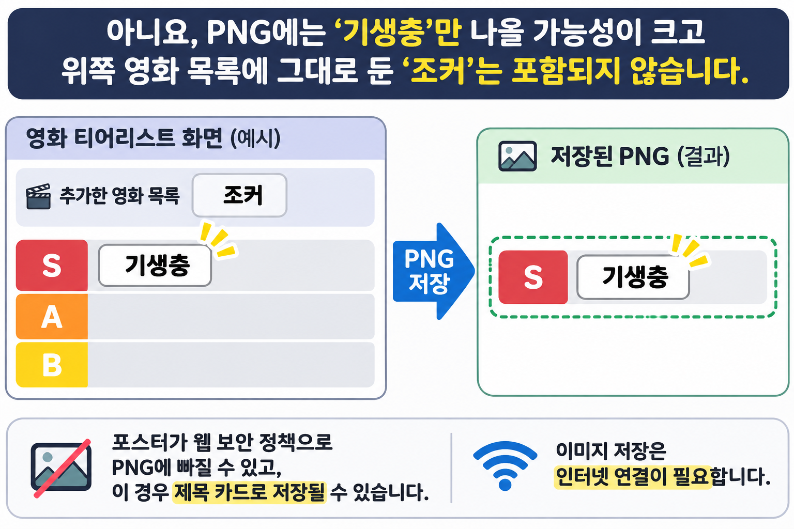

# 보너스 2. AI 응답을 시각 자료로 만들기

요구사항 5의 [작업기록 13 · Gemini의 답변](../../docs/run-log.md#dialogue-20)을 ChatGPT 이미지 생성에 입력해 영화 티어리스트의 PNG 저장 범위를 설명하는 그림 한 장을 만들었다.

## 생성 결과



카드가 놓인 위치에 따라 저장 여부가 어떻게 달라지는지 보여 주는 설명 그림이다. 왼쪽 등급표에는 S·A·B만, 오른쪽에는 S행만 그려져 있다. 실제 앱의 저장 대상은 화면에 보이는 티어리스트 영역이다.

## 이미지 생성에 입력한 AI 응답 원문

```text
**아니요, PNG에는 ‘기생충’만 나올 가능성이 크고 위쪽 영화 목록에 그대로 둔 ‘조커’는 포함되지 않습니다.**


판단 근거가 된 기획서 문장은 다음과 같습니다.


- **‘3-2. 포스터 표시 — 이미지 저장 제한’:** `PNG 저장은 화면에 보이는 티어리스트 영역만 담는다. 추가한 영화 목록은 포함하지 않는다.`
- **‘3-2. 포스터 표시 — 이미지 저장 제한’:** `포스터는 웹 보안 정책에 따라 PNG에 빠질 수 있으며, 이 경우 제목 카드 형태로 저장될 수 있다.`
- **‘3-2. 포스터 표시 — 이미지 저장 제한’:** `이미지 저장은 인터넷 연결이 필요하다(html2canvas를 CDN에서 불러옴).`  &#x20;

따라서 S등급 티어리스트 영역에 들어간 ‘기생충’은 저장 대상에 포함되지만, 위쪽 ‘추가한 영화 목록’에 남아 있는 ‘조커’는 PNG 저장 범위에서 빠집니다. 또 기생충의 포스터가 웹 보안 정책 때문에 PNG에 담기지 못하면 제목 카드 형태로 저장될 수 있으며, 이미지 저장 자체도 인터넷 연결이 필요합니다.
```

## 원문 앞에 붙인 이미지 제작 요청

아래 응답 원문을 한 장의 한국어 시각 자료로 바꿔 주세요. 영화 티어리스트 화면의 위쪽 ‘추가한 영화 목록’에 ‘조커’, 아래 S등급에 ‘기생충’ 제목 카드를 배치하고, 저장된 PNG 쪽에는 S등급 ‘기생충’만 보이게 해 주세요. 간결한 도해와 큰 한글, 잘리지 않는 여백을 사용하고, 포스터 대신 제목 카드로 저장될 수 있다는 점과 인터넷 연결이 필요하다는 점은 아래에 짧게 표시해 주세요.
