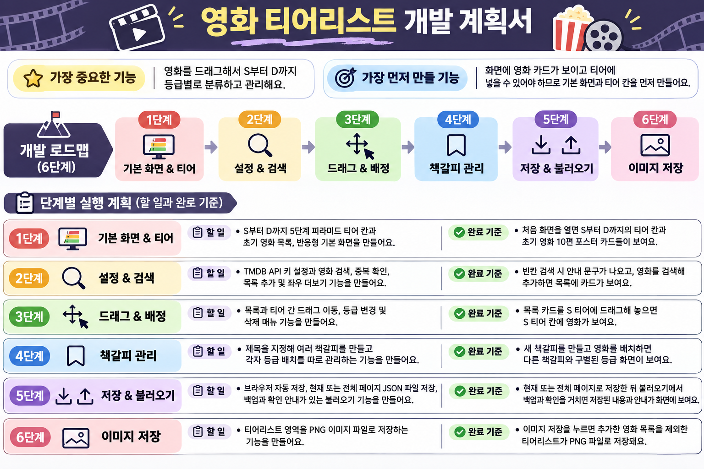

# 보너스 2. 미해결 과업의 텍스트 수정안을 이미지로 만들기

Gemini는 이미지 생성 한도에 도달해 영화 티어리스트의 수정본을 **6단계 텍스트 계획서**로 남겼다. 보너스 2에서는 그때 받은 답변 전체를 ChatGPT 이미지 생성에 입력했다. 당시 중단한 경위와 이번에 사용한 원문은 각각 [미해결 과업 1](../../docs/unresolved.md#과업-1--영화-티어리스트-인포그래픽-수정본-생성)과 [실행 로그 작업기록 35 · AI 답변](../../docs/run-log.md#dialogue-62)에서 확인할 수 있다.

## 생성한 시각 자료



4단계에서 책갈피별 영화 배치를 따로 관리한다. 5단계에서 현재·전체 페이지 저장과 백업 후 불러오기를 함께 다루고, 6단계에서 티어리스트 영역만 PNG로 저장한다. 이 이미지는 당시 Gemini의 출력과 구분해 이번 보너스 과제의 결과로 기록한다.

## 이미지 생성에 입력한 AI 답변 원문

````text
아쉽지만 현재 이미지 생성 할당량이 모두 차서 인포그래픽 이미지를 새로 만들지 못했어요. 할당량이 재설정된 뒤 다시 요청해 주시면 바로 만들어 드릴게요!

대신 말씀하신 대로 **오타를 고치고, 책갈피를 따로 둔 뒤, 저장하기와 불러오기를 합친 6단계 개발 계획서**를 텍스트로 먼저 정리해 드릴게요.

---

# 영화 티어리스트 개발 계획서

* **가장 중요한 기능**: 영화를 드래그해서 S부터 D까지 등급별로 분류하고 관리해요.
* **가장 먼저 만들 기능**: 화면에 영화 카드가 보이고 티어에 넣을 수 있어야 하므로 기본 화면과 티어 칸을 먼저 만들어요.

## 로드맵

1단계 기본 화면 & 티어 → 2단계 설정 & 검색 → 3단계 드래그 & 배정 → 4단계 책갈피 관리 → 5단계 저장 & 불러오기 → 6단계 이미지 저장

## 단계별 실행 순서

* **1단계 | 기본 화면 & 티어**
* **할 일**: S부터 D까지 5단계 피라미드 티어 칸과 초기 영화 목록, 반응형 기본 화면을 만들어요.
* **✅ 완료 기준**: 처음 화면을 열면 S부터 D까지의 티어 칸과 초기 영화 10편 포스터 카드들이 보여요.


* **2단계 | 설정 & 검색**
* **할 일**: TMDB API 키 설정과 영화 검색, 중복 확인, 목록 추가 및 좌우 더보기 기능을 만들어요.
* **✅ 완료 기준**: 빈칸 검색 시 안내 문구가 나오고, 영화를 검색해 추가하면 목록에 카드가 보여요.


* **3단계 | 드래그 & 배정**
* **할 일**: 목록과 티어 간 드래그 이동, 등급 변경 및 삭제 메뉴 기능을 만들어요.
* **✅ 완료 기준**: 목록 카드를 S 티어에 드래그해 놓으면 S 티어 칸에 영화가 보여요.


* **4단계 | 책갈피 관리**
* **할 일**: 제목을 지정해 여러 책갈피를 만들고 각자 등급 배치를 따로 관리하는 기능을 만들어요.
* **✅ 완료 기준**: 새 책갈피를 만들고 영화를 배치하면 다른 책갈피와 구별된 등급 화면이 보여요.


* **5단계 | 저장 & 불러오기**
* **할 일**: 브라우저 자동 저장, 현재 또는 전체 페이지 JSON 파일 저장, 백업과 확인 안내가 있는 불러오기 기능을 만들어요.
* **✅ 완료 기준**: 현재 또는 전체 페이지로 저장한 뒤 불러오기에서 백업과 확인을 거치면 저장된 내용과 안내가 화면에 보여요.


* **6단계 | 이미지 저장**
* **할 일**: 티어리스트 영역을 PNG 이미지 파일로 저장하는 기능을 만들어요.
* **✅ 완료 기준**: 이미지 저장을 누르면 추가한 영화 목록을 제외한 티어리스트가 PNG 파일로 저장돼요.


---

이 6단계 구성과 완료 기준 중에서 다듬고 싶은 문장이 있으신가요?
````

## 원문 앞에 붙인 제작 지시

아래 AI 응답의 ‘영화 티어리스트 개발 계획서’를 한국어 인포그래픽 한 장으로 시각화해줘. 제목, 가장 중요한 기능과 먼저 만들 기능, 가로로 이어지는 6단계 로드맵, 같은 순서의 단계별 할 일과 완료 기준을 보여줘. 가로 로드맵 아래에는 가로로 긴 실행 카드 6개를 세로로 쌓고, 각 카드에는 해당 단계 번호·제목·할 일·완료 기준을 넣어줘. 원문의 동작과 조건을 유지하고, 한글이 잘리지 않도록 여백을 확보해줘. 처음과 끝의 대화 문구는 그림에 넣지 않아도 돼.

<details>
<summary>이전 시각화 · PNG 저장 범위</summary>

요구사항 5의 [작업기록 13 · Gemini의 답변](../../docs/run-log.md#dialogue-20)을 ChatGPT 이미지 생성에 입력해 영화 티어리스트의 PNG 저장 범위를 설명하는 그림 한 장을 만들었다.

## 생성 결과


카드가 놓인 위치에 따라 저장 여부가 어떻게 달라지는지 보여 주는 설명 그림이다. 왼쪽 등급표에는 S·A·B만, 오른쪽에는 S행만 그려져 있다. 실제 앱의 저장 대상은 화면에 보이는 티어리스트 영역이다.

## 이미지 생성에 입력한 AI 응답 원문

```text
**아니요, PNG에는 ‘기생충’만 나올 가능성이 크고 위쪽 영화 목록에 그대로 둔 ‘조커’는 포함되지 않습니다.**


판단 근거가 된 기획서 문장은 다음과 같습니다.


- **‘3-2. 포스터 표시 — 이미지 저장 제한’:** `PNG 저장은 화면에 보이는 티어리스트 영역만 담는다. 추가한 영화 목록은 포함하지 않는다.`
- **‘3-2. 포스터 표시 — 이미지 저장 제한’:** `포스터는 웹 보안 정책에 따라 PNG에 빠질 수 있으며, 이 경우 제목 카드 형태로 저장될 수 있다.`
- **‘3-2. 포스터 표시 — 이미지 저장 제한’:** `이미지 저장은 인터넷 연결이 필요하다(html2canvas를 CDN에서 불러옴).`  &#x20;

따라서 S등급 티어리스트 영역에 들어간 ‘기생충’은 저장 대상에 포함되지만, 위쪽 ‘추가한 영화 목록’에 남아 있는 ‘조커’는 PNG 저장 범위에서 빠집니다. 또 기생충의 포스터가 웹 보안 정책 때문에 PNG에 담기지 못하면 제목 카드 형태로 저장될 수 있으며, 이미지 저장 자체도 인터넷 연결이 필요합니다.
```

## 원문 앞에 붙인 이미지 제작 요청

아래 응답 원문을 한 장의 한국어 시각 자료로 바꿔 주세요. 영화 티어리스트 화면의 위쪽 ‘추가한 영화 목록’에 ‘조커’, 아래 S등급에 ‘기생충’ 제목 카드를 배치하고, 저장된 PNG 쪽에는 S등급 ‘기생충’만 보이게 해 주세요. 간결한 도해와 큰 한글, 잘리지 않는 여백을 사용하고, 포스터 대신 제목 카드로 저장될 수 있다는 점과 인터넷 연결이 필요하다는 점은 아래에 짧게 표시해 주세요.

</details>
