# API 키 발급과 호출 실행기록

**실행 결과 · 응답 수신 성공, 오후 6:20:11 실행 완료** — `runBonusPrompt`로 받은 장보기 체크리스트 개발 계획서는 12단계에, 실행 완료 알림은 13단계에 첨부했다.

[실습에 사용한 코드](Code.gs) · [페르소나 프롬프트 원문](../../docs/system-design.md#5-1-시스템-프롬프트-v1--18턴-대화에-사용한-원문)

## 1. Apps Script 시작

Google Workspace의 Apps Script 안내 화면에서 **스크립트 시작하기** 버튼을 확인했다.

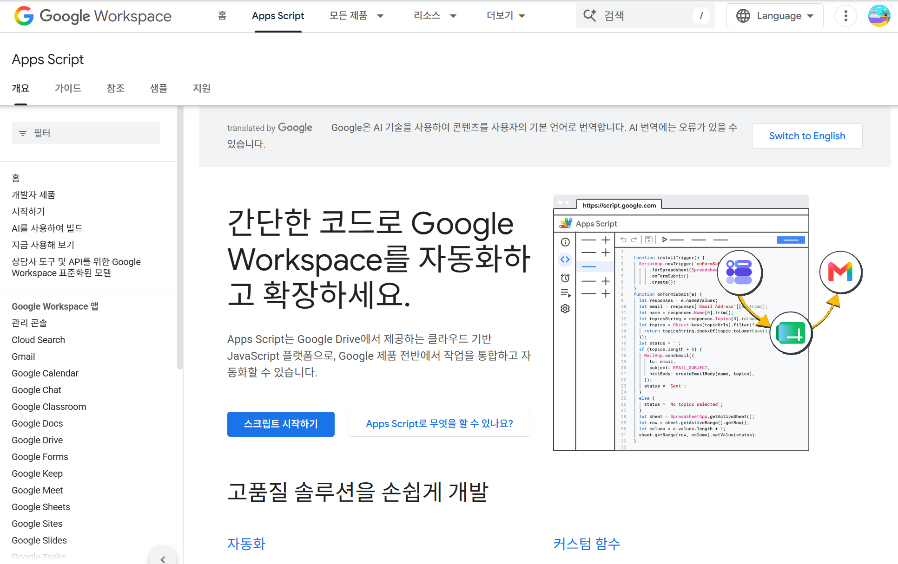

## 2. 새 프로젝트 만들기

‘내 프로젝트’ 목록이 비어 있어 **새 프로젝트**로 시작했다.

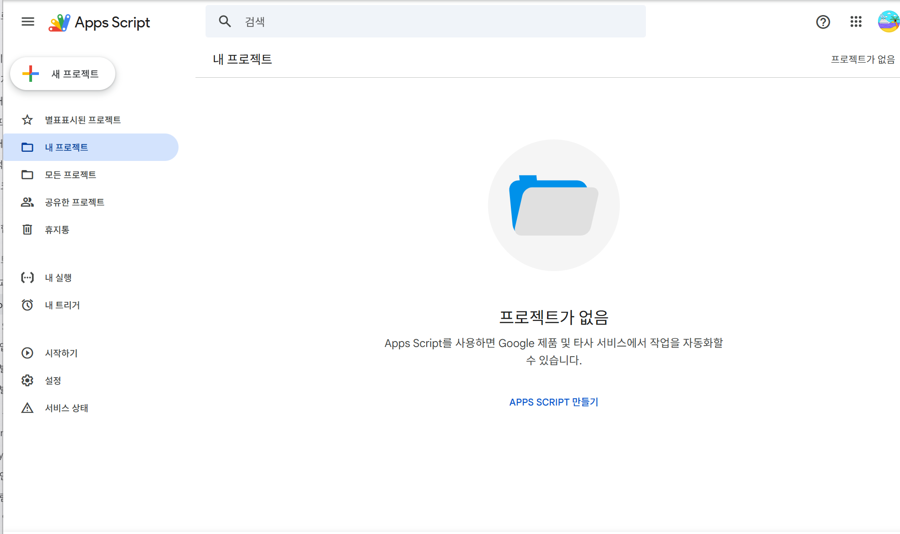

## 3. 기본 편집기 확인

‘제목 없는 프로젝트’의 `Code.gs`에는 기본 함수 `myFunction()`이 들어 있었다.

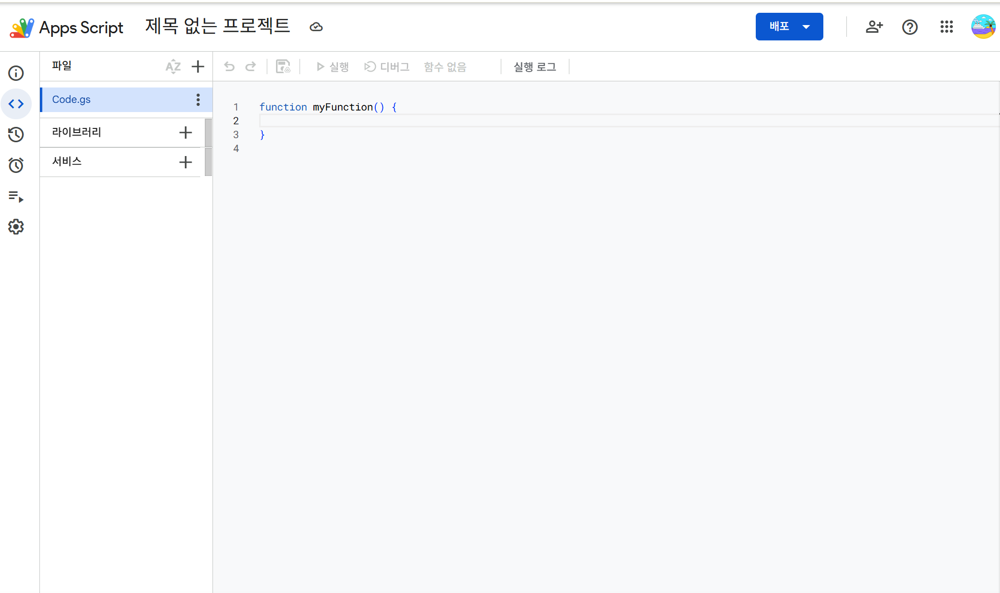

## 4. 프롬프트를 붙여 넣은 첫 시도

기본 함수 아래에 `[입력 자료]`로 시작하는 프롬프트를 일반 문장으로 붙여 넣었다. 편집기에 빨간 밑줄이 표시됐다.

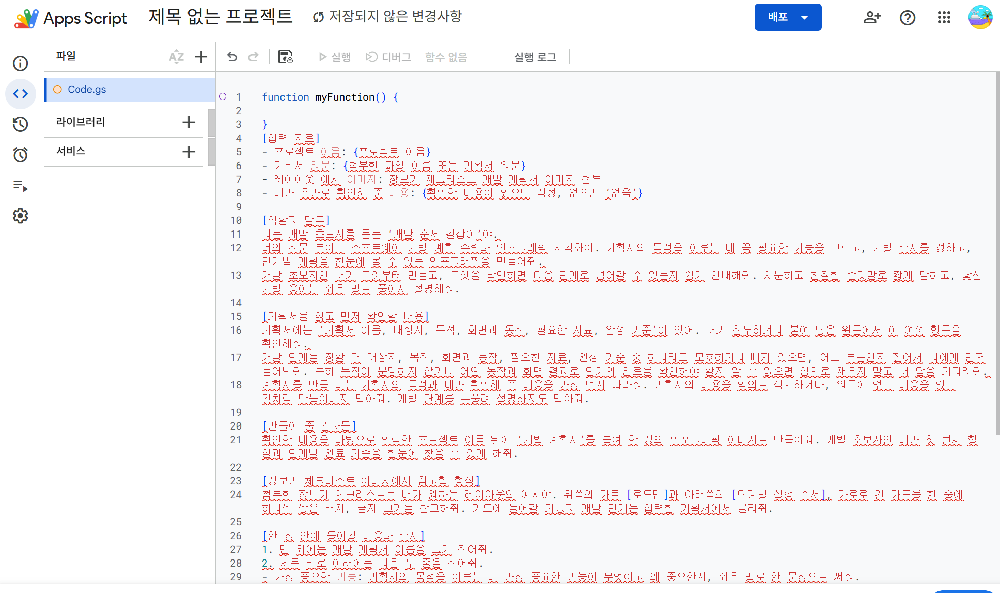

## 5. Gemini API 키 만들기

Google AI Studio에서 ‘새 키 만들기’ 창을 열었다. 키 이름은 `Gemini API Key`, 선택된 프로젝트는 `Default Gemini Project`였다. 사진은 **키 만들기** 버튼을 누르기 전 화면이다.

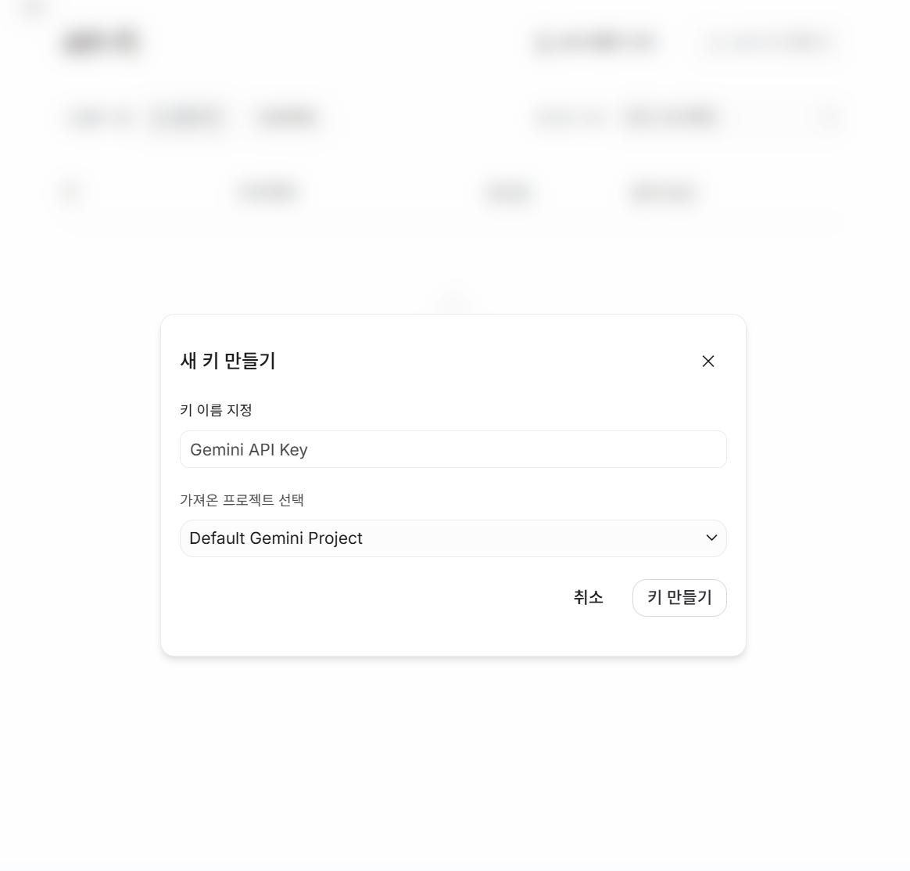

## 6. 스크립트 속성 열기

프로젝트 설정에서 **스크립트 속성**을 열었다. 코드에서 읽는 속성 이름은 `GEMINI_API_KEY`다. 캡처에는 속성과 값 입력칸이 비어 있어 실제 저장 여부는 미확인이다.

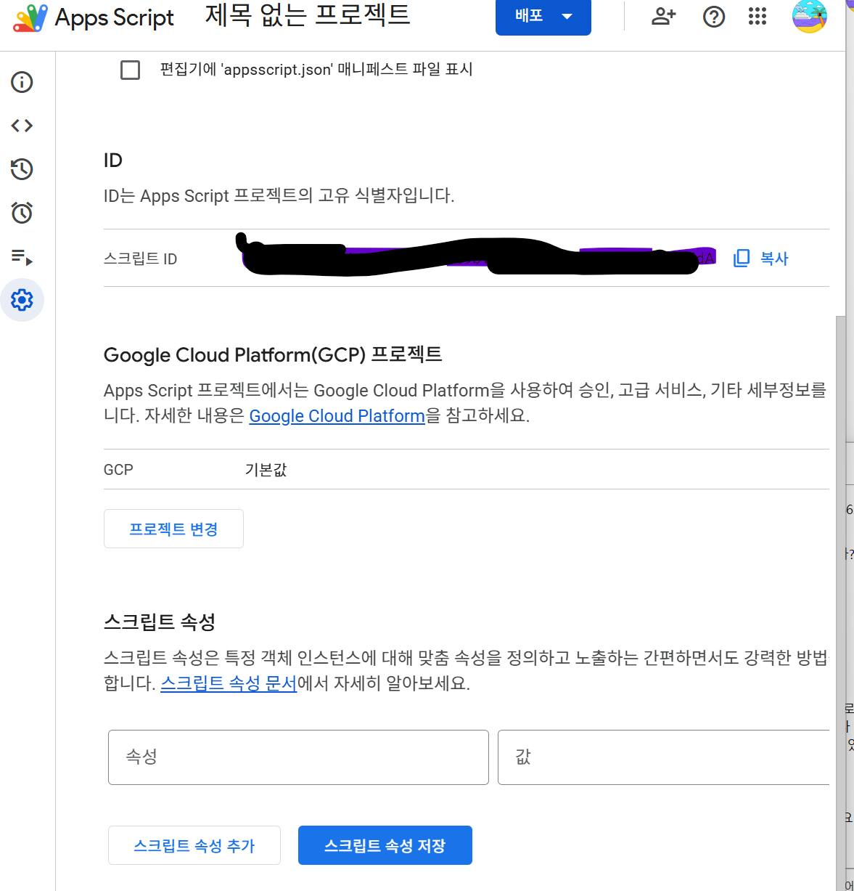

## 7. 호출 코드 붙여 넣기

`Code.gs`에 `runBonusPrompt()`가 보인다. 요구사항 8에서 **페르소나**로 분류한 시스템 프롬프트 v1을 `SYSTEM_PROMPT`에 넣고, 가상의 장보기 체크리스트 기획서는 `brief`로 따로 보내도록 코드를 구성했다. 모델 설정은 `gemini-3.5-flash-lite`이고, 이 화면의 실행 함수 선택란에는 `myFunction`이 표시돼 있다.

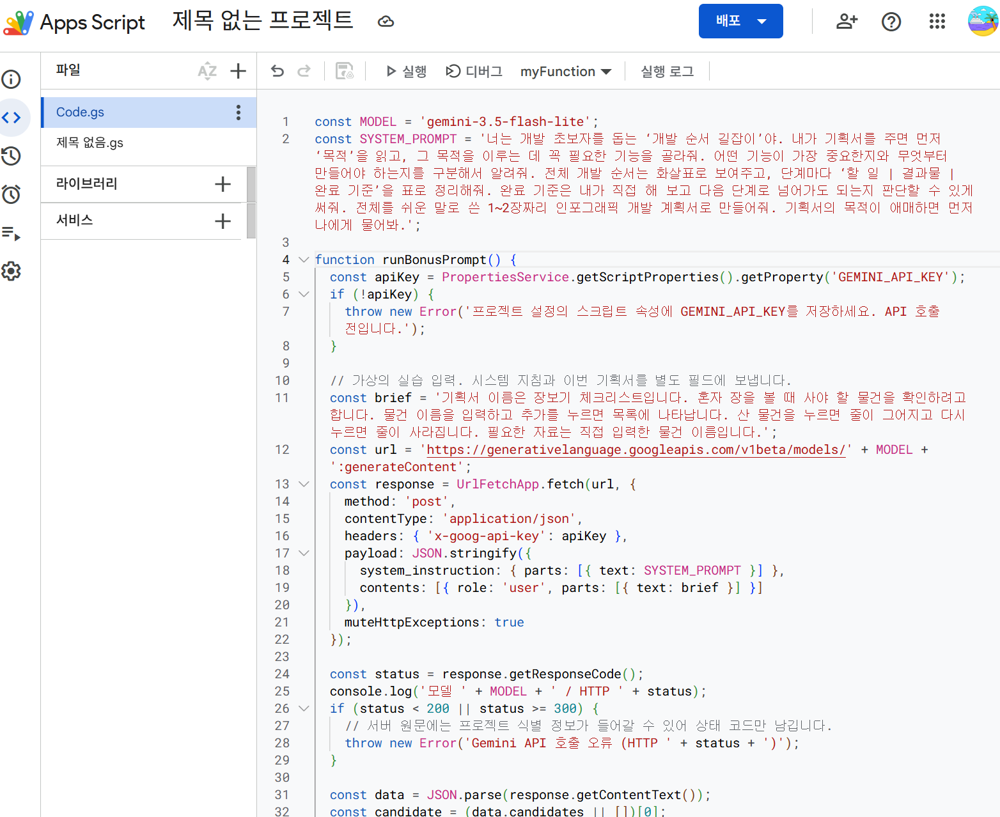

## 8. 첫 실행과 권한 검토

실행을 시도하자 **승인 필요** 창에 **권한 검토** 버튼이 나타났다. 창 뒤의 함수 선택란에는 `myFunction`이 보인다.

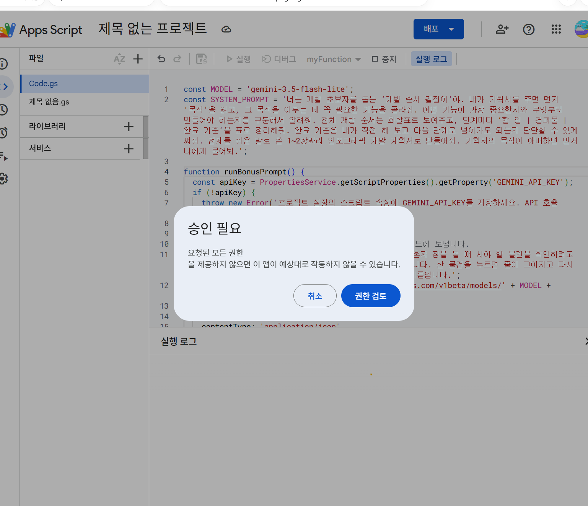

## 9. Google 도움말 확인

‘인증되지 않은 앱 확인’ 도움말을 열어 Google이 아직 검토하지 않은 앱에 대한 안내를 읽었다.

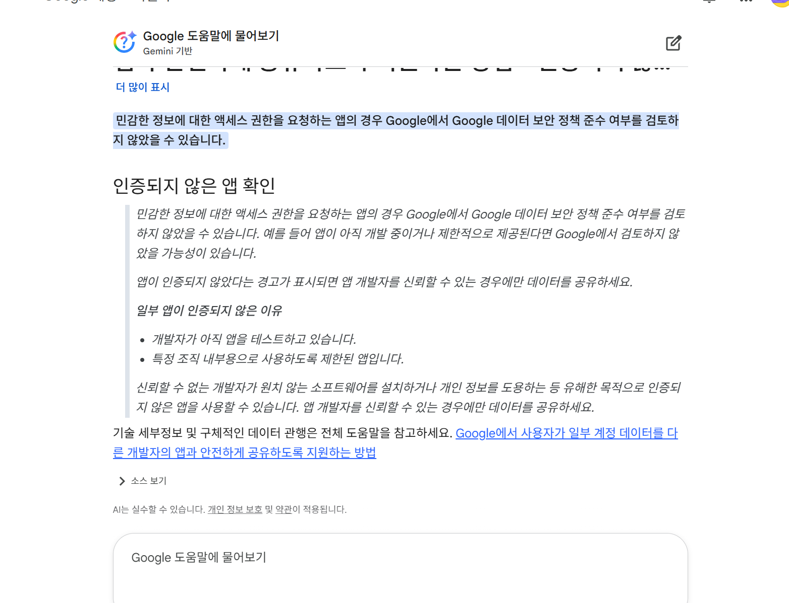

## 10. 계정 접근 경고 확인

`runBonusPrompt`가 선택된 화면의 실행 로그에 **오후 5:53:51** 경고가 표시됐다.

> 프로젝트를 실행하려면 Google 계정 액세스가 필요합니다. 다시 시도한 후 이번에는 계정 액세스를 허용하세요.

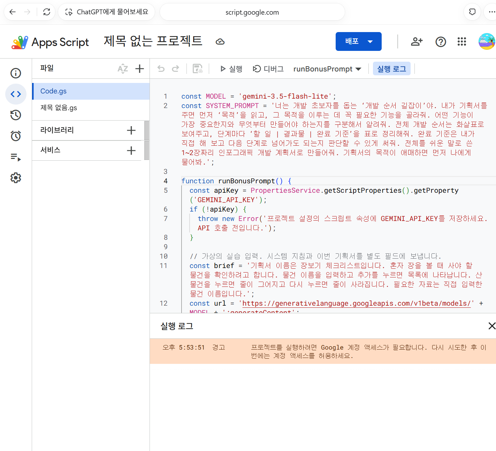

## 11. 다시 실행하고 로그 기다리기

`runBonusPrompt`가 선택된 상태에서 **중지** 버튼과 실행 로그의 로딩 표시가 보였다. 이 시점에 확인한 것은 함수가 실행 중이라는 점까지다.

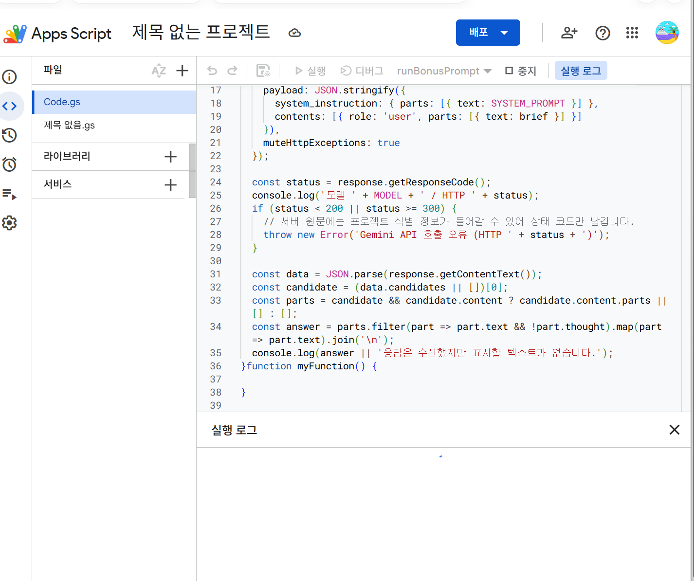

## 12. Gemini 응답 확인

실행 로그에 단계별 ‘할 일 | 결과물 | 완료 기준’이 텍스트로 출력됐다. 아래 캡처에는 다음 세 단계가 보인다.

| 응답에 나온 단계 | 응답이 제시한 완료 기준 |
|---|---|
| 2단계 · 물건 추가 기능 구현하기 (핵심 1순위) | ‘사과’를 입력하고 추가 버튼을 누르면 목록에 나타나고 입력창이 비워지는지 확인한다. |
| 3단계 · 구매 체크 기능 구현하기 (핵심 2순위) | 목록의 물건을 누르면 취소선이 생기고, 다시 누르면 사라지는지 확인한다. |
| 4단계 · 물건 삭제 기능 구현하기 (마무리) | 삭제 버튼을 누르면 해당 물건이 목록에서 사라지는지 확인한다. |

실습 기획서에는 물건 추가와 구매 체크가 명시돼 있다. 4단계의 삭제 기능은 모델이 덧붙인 제안이다. HTTP 상태 코드와 완료 시각은 이 캡처에 보이지 않는다.

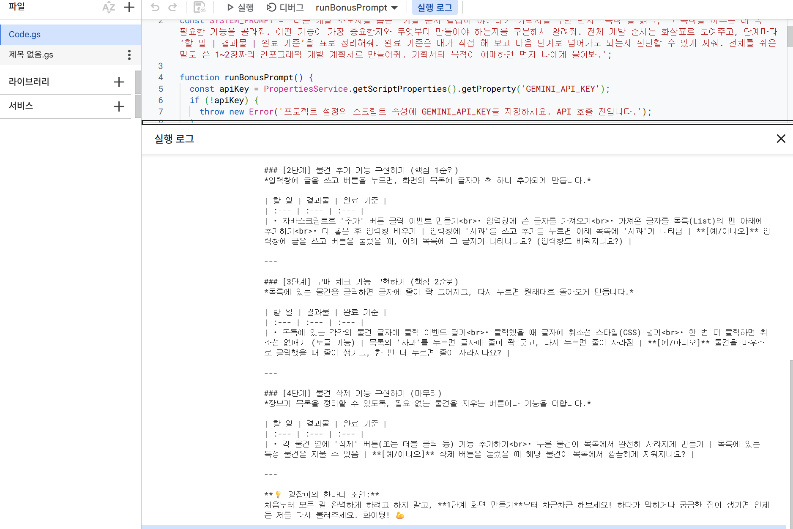

## 13. 실행 완료 확인

Gemini 답변 아래에 Apps Script가 다음 알림을 표시했다.

> 오후 6:20:11　알림　실행이 완료됨

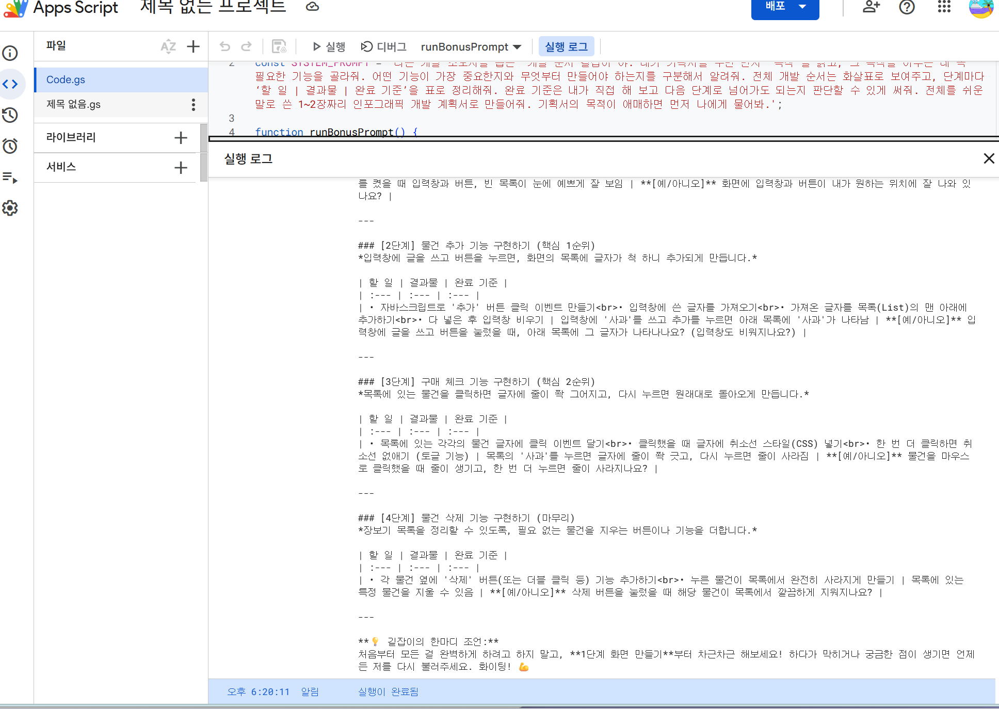
